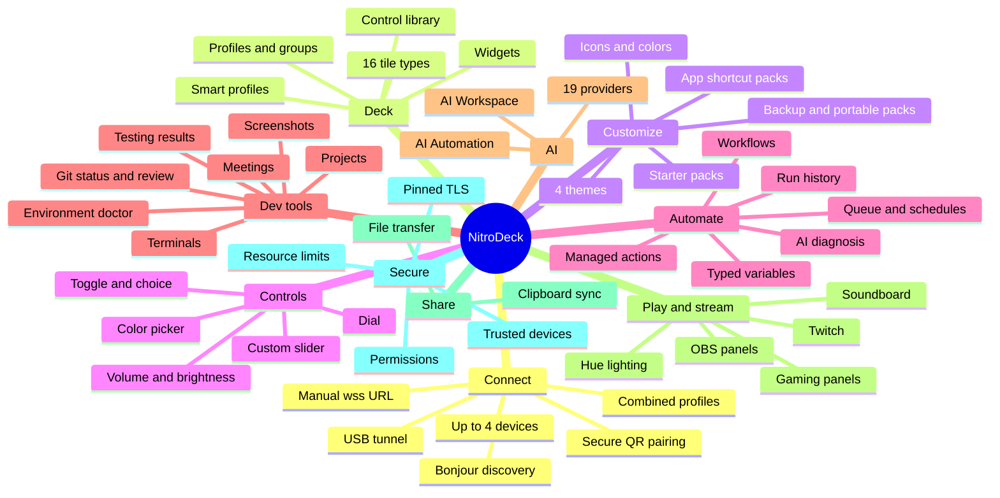
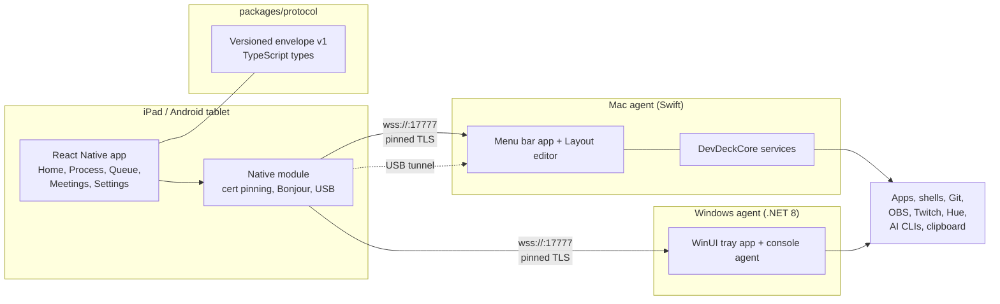
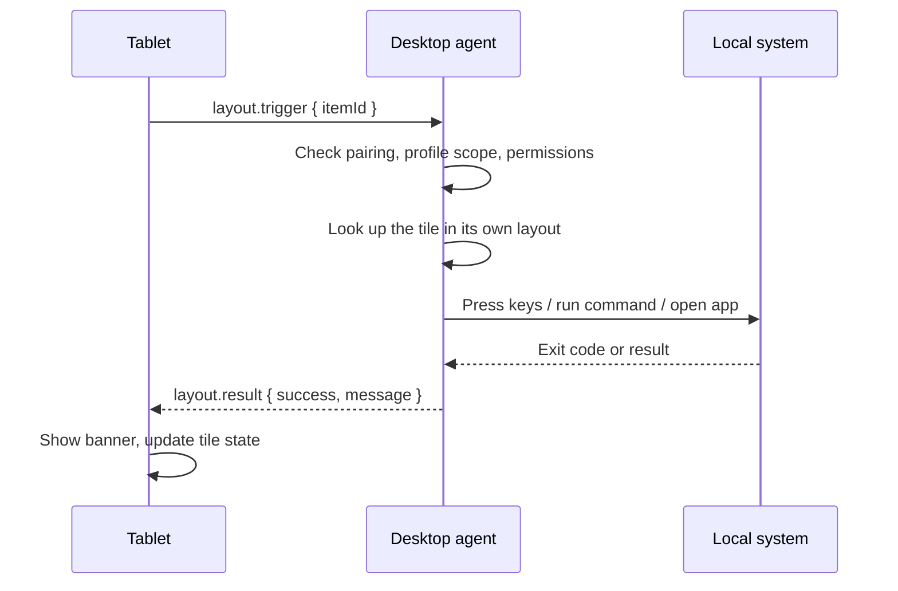

# NitroDeck feature guide

NitroDeck turns an iPad (or Android tablet) into a programmable control deck for Mac and Windows computers. This guide lists every feature and service in the repository, every customization and configuration surface, how the pieces connect, and how to get from zero to a working deck.

An interactive version of this guide, with an explorable feature map, lives in [`site/`](../site/index.html) and is published to GitHub Pages by [`.github/workflows/pages.yml`](../.github/workflows/pages.yml).

Sources for this guide: the root README, `docs/` (protocol, security, architecture, AI, packs, USB, sharing), `apps/ipad`, `apps/mac-agent`, `apps/windows-agent`, `packages/protocol`, and `design/`. Where a feature is limited to one platform, the table says so.

## Contents

1. [Visual map](#visual-map)
2. [Parts of the system](#parts-of-the-system)
3. [Connection and pairing](#connection-and-pairing)
4. [The deck: profiles, tiles and widgets](#the-deck-profiles-tiles-and-widgets)
5. [Customization](#customization)
6. [Analog controls](#analog-controls)
7. [Workflows, actions and the queue](#workflows-actions-and-the-queue)
8. [Developer tools](#developer-tools)
9. [AI assistants](#ai-assistants)
10. [Gaming and streaming](#gaming-and-streaming)
11. [File sharing and shared clipboard](#file-sharing-and-shared-clipboard)
12. [Security model](#security-model)
13. [Configuration reference](#configuration-reference)
14. [Integrations](#integrations)
15. [Get started](#get-started)
16. [End-to-end walkthrough](#end-to-end-walkthrough)
17. [End-to-end verification](#end-to-end-verification)
18. [Known limits](#known-limits)

## Visual map

### Feature map



### System architecture



### Request flow for one tile tap



## Parts of the system

NitroDeck ships as three apps: the **Mac agent**, the **Windows agent** and the **mobile app** (iPad and Android). The rows below mark the mobile app as "iPad app" because its source lives in `apps/ipad`.

| Part | Path | Stack | Role |
|---|---|---|---|
| iPad app | `apps/ipad` | Expo, React Native 0.86, TypeScript | The deck, dashboards, workflow runner, sharing screen. Also builds for Android and runs in a browser through a loopback relay. |
| Mac agent | `apps/mac-agent` | Swift 6, SwiftUI, AppKit | Menu bar app and Layout editor. Owns layouts, projects, workflows, credentials and every action. Targets: `DevDeckAgent` (UI), `DevDeckCore` (services). |
| Windows agent | `apps/windows-agent` | .NET 8, WinUI 3 | `DevDeck.WindowsAgent` (console agent), `DevDeck.WinUIDesktop` (tray and settings app), `DevDeck.WindowsAgent.Tests`, Inno Setup installer. |
| Protocol | `packages/protocol` | TypeScript | Versioned message envelope and types shared with the Swift and C# models. `docs/protocol.md` is the source of truth. |
| Discovery module | `apps/ipad/modules` | Expo native module | Bonjour browsing, USB discovery, certificate-pinned transport. |
| Promo video | `promo` | Remotion | Scripted product video. |
| Design assets | `design` | SVG, Markdown | Brand kit, design system, audits. |

The desktop agent is the authority. The tablet asks for typed actions by id and never sends arbitrary shell commands.

## Connection and pairing

| Feature | Details |
|---|---|
| Secure transport | TLS WebSockets (`wss://`) on port `17777`. The agent's TLS identity persists (Mac Keychain, Windows current-user certificate). |
| QR pairing | The QR or URL carries the certificate SHA-256 fingerprint. The tablet checks it before releasing credentials. URL form: `wss://<host>:17777/#fingerprint=<sha256>`. |
| Pairing code | Six digits, expires after five minutes, rotates after use, with failed-attempt lockout. |
| Trusted devices | The Mac stores trusted tablets in Keychain; the Windows agent uses a random per-device secret in Credential Manager. Revoke from Security preferences (Mac) or `device revoke <id>` (Windows). |
| Bonjour discovery | The Mac advertises `_devdeck._tcp.local.` with agent UUID and fingerprint. The tablet updates a saved endpoint when it sees the same fingerprint at a new address. Discovery alone never establishes trust. |
| Manual entry | Type a secure URL and pairing code. Required where Bonjour is unavailable (Windows agent, Expo Go). |
| USB | Mac to iPad through the system `usbmuxd` (tablet loopback port `17778`) and Mac to Android through `adb`. USB wins while plugged in, then falls back to the saved network address. Windows USB is not implemented. |
| Multiple devices | Up to four agents stay connected at once. Each has its own logs, permissions, workflows and controls. Use the device switcher in the header. |
| Transport badges | Each device is labelled Local, VPN (Tailscale ranges and `*.ts.net`), USB or Remote, judged from the address. |
| Reconnection | Capped backoff, immediate retry on app foreground or discovery. Paired agents reconnect without a new code after a LAN address change. |
| Combined profiles | A profile on the tablet built from tiles of several devices. Saved only on the tablet. Tiles show their source device and dim when it disconnects. |
| Browser testing | `npm run web --workspace @devdeck/ipad` starts a loopback relay that verifies the fingerprint and keeps the upstream connection on `wss://`. |

## The deck: profiles, tiles and widgets

Profiles are built in the Mac agent's **Layout** tab (or the Windows app and console) and sent to the tablet as `layout.config`. The tablet only displays them.

### Structure

- A **Home** profile (automatic or hand-built), plus any number of custom profiles.
- **Groups** that nest as deep as needed.
- Drag to reorder in the Layout editor. Tiles span 1, 2 or 4 columns.
- **Smart profiles**: link a profile to an app and the tablet switches Home profile when that app is frontmost (a toggle in tablet Settings; a profile lock keeps a manual choice).
- **Control Library**: a catalog of ready tiles you drag into the layout.

### Item and tile types

| Type | What it does |
|---|---|
| `app` | Launches an allowed application. Shows the app's own icon. |
| `action` | Runs a managed action (npm script, Git action, workflow). |
| `project` | Opens a project workspace. |
| `shortcut` | Presses one or more key steps in a row, including modifier-only steps. |
| `text` | Types a snippet into the frontmost app, optionally pressing Return. |
| `command` | Runs a shell command, AppleScript or Apple Shortcut with a 60 second limit. |
| `system` | Media and system actions: volume up and down, mute, play/pause, next, previous, brightness, lock screen, display sleep, sleep, screen saver. |
| `console` | Opens a terminal view. |
| `stats` | Live CPU, memory and uptime. |
| `notes` | A text note tile. |
| `group` | A folder of tiles. |
| `slider` | Volume or brightness slider in line or ring style, one tile, two tiles or full width. |
| `control` | A custom analog control that runs your command. See [Analog controls](#analog-controls). |
| `obs` | Live OBS panel. |
| `gaming` | Gaming and streaming panel. |
| AI widgets | **AI Workspace** and **AI Automation**. |

Tile states: idle, pressed, selected, running (blue border and spinner), succeeded (green border and check), failed (red border and `!`), unavailable (dimmed). Status is never colour alone: each has a glyph and a label.

Widgets on the Home page include weather, media, metrics and terminal widgets.

### Tablet pages

| Page | Purpose |
|---|---|
| Home | The active profile's tiles, plus pinned items. |
| Process | Running processes, live terminal output, input and key sending. |
| Queue | Workflow queue, schedules and run history. |
| Meetings | Calendar from the desktop agent. |
| Settings | Connection, Appearance, Profile, Activity and Advanced sub-pages. |
| Project Workspace | Per-project actions, doctor checks, Git state. |
| Workflow | Run a workflow with variables and see its step timeline. |
| Testing | Test results from actions that emit `NITRODECK_RESULT`. |
| Git & Deploy | Git status, review deck, fetch, pull, push. |
| Screenshots | Captures from the desktop. |
| Share | File and clipboard sharing between computers. |

## Customization

### Appearance

| Option | Details |
|---|---|
| Themes | Four palettes: **Neutral Light**, **Neutral Dark**, **Cobalt**, **Ember**. A **Follow system** switch picks light or dark automatically. Contrast is enforced by tests. |
| Tile icons | Any SF Symbol (with a symbol picker) or an uploaded image. The agent renders it to a PNG data URL for the tablet. |
| Tile colours | Background and text colour as `#rrggbb`. Defaults keep the app's own icon. |
| Glyphs | An emoji or glyph on system tiles. |
| Spans | Tile and widget width: small, medium, large (slider sizes) or span 1 to 4. |
| Reduced motion | The app respects the system setting. |
| Design tokens | `src/theme/tokens.ts`: spacing 4, 8, 12, 16, 24; radius 8, 12, 16, pill; motion 120 and 180 ms; type scale 12 to 22. Tap targets are at least 44 pt. |

### Starting points

| Option | Details |
|---|---|
| Starter packs | **Gaming + Streaming**, **Gaming**, **Streaming**. Create a profile or add a group, selecting only the controls you want. Installed copies are independent of the catalog. |
| App shortcut packs | 24 original Mac packs plus 33 added packs: 43 Mac-compatible apps in all, including Microsoft Office, browsers, Discord, Zoom, JetBrains IDEs, Cursor, ChatGPT, Claude, Steam, OBS, Spotify, Figma, Blender, Audacity, Obsidian, Notion and Adobe apps. |
| Video and photo packs | Final Cut Pro, Premiere Pro, DaVinci Resolve, iMovie, After Effects, CapCut, Lightroom Classic, Affinity Photo, Pixelmator Pro, GIMP, Photoshop, with jog dials for frame step, shuttle, brush size, zoom and undo history. |
| Portable packs | `format: "nitrodeck-pack"`, `version: 1` JSON with a strict safe-field whitelist. Import creates new IDs and resolves executable targets locally. |
| Backup | Full profile backup and restore (separate from portable packs). |
| Shortcut editor | Record key combinations, manual key picker, presets for combos macOS keeps for itself (such as Cmd+Tab). |

## Analog controls

A `control` tile runs your command each time the tablet changes it. Only a number, a `#rrggbb` colour or one of the control's own choices is ever placed into the command.

| Kind | Tablet shows | Placeholders |
|---|---|---|
| `slider` | Line or ring over `rangeMin` to `rangeMax` in `rangeStep` steps with a unit | `{value}` |
| `color` | Hue, saturation and brightness strips and swatches | `{hex}` `{hexnohash}` `{r}` `{g}` `{b}` `{r16}` `{g16}` `{b16}` `{h}` `{s}` `{v}` |
| `toggle` | A switch, one or two tiles wide | `{state}` `{on}` |
| `choice` | A row of labelled values | `{value}` |
| `dial` | An endless dial. Each notch presses keys (`tickForward`, `tickBackward`), at most 20 per message. Never runs a command. | none |

`commandKind` is `shell` or `applescript`. An optional `readScript` prints the current value so the control starts in the right place. Protocol: `control.get`, `control.set`, `control.value`.

## Workflows, actions and the queue

### Managed actions

- npm package scripts detected from each project's `package.json`.
- Git actions: `git:fetch`, `git:pull`, `git:push` (push needs a confirmation on the Mac).
- `workflow:verify`, built from a project's `lint`, `typecheck` and `test` scripts.
- URL shortcuts that run through `open` on the Mac.
- Saved terminal commands.

Processes run in a pseudo-terminal (120 by 40), so interactive menus and prompts work. The tablet answers a waiting process with `process.input` (a line) or `process.key` (exact bytes, such as arrow keys). Stop kills child processes and escalates to force-kill.

### Workflows

| Feature | Details |
|---|---|
| Steps | Terminal commands, keyboard shortcuts, text, URLs, system actions and nested workflows. |
| Conditions | One optional condition per step: a variable equals or does not equal a value, or an earlier step succeeded or failed. Unmet steps are marked skipped. |
| Typed variables | `text` or `list`. List sources: `manual`, `gitBranches`, `command` (10 second timeout, 64 KB limit). Referenced as `{{name}}`. Values are validated and quoted for shell contexts. |
| Queue | Runs wait their turn. Each run has an id such as `#a1b2`, owner and timings. |
| Scheduling | One-time (`runAt`) or recurring (hour, minute, weekdays, IANA time zone, expiry). Missed runs on restart are handled once. Daylight saving follows time zone rules. |
| Run history and clear | Per-workflow history and `workflow.clear`. |
| Progress | `workflow.progress` drives the step timeline: Pending, Running, Succeeded, Failed, Skipped. |
| Notifications | Optional macOS notifications on action and workflow success or failure. |
| Repair | A workflow repair panel and an AI diagnosis that reads real run steps. |

## Developer tools

| Tool | What it gives you |
|---|---|
| Project registry | Add folders in the agent; the tablet switches the selected project. Package manager and Git branch detected. |
| Git status | Branch, ahead and behind, optional `diffStat`, up to 16 worktrees. Read-only. |
| Git review deck | Turns Git status into a short review checklist. |
| Testing results | The agent parses a bounded `NITRODECK_RESULT {json}` marker: test counts and failure excerpts. Display only. |
| Environment doctor | Checks required tools for the project's actions. |
| Workspace doctor | Checks project, Git, scripts and connection state. |
| Service health | Local service definitions and status. |
| Terminals | List and kill common terminal processes, open interactive terminals (unrestricted devices only). |
| Screenshots | Screen captures streamed to the tablet. |
| Meetings | Calendar from the desktop (Mac). |
| System stats | CPU, memory, uptime and managed-process count. |
| Frontmost app | Reported to the tablet for smart profiles. |

## AI assistants

In the Layout editor, **Layout → AI** adds **AI Workspace** (manual assistant choice and handoff) or **AI Automation** (ordered **Plan**, **Implement**, **Review** steps with approval gates, pause, retry and resume). Automation runs on the Mac agent; Windows has no managed AI runner.

AI widgets show message bubbles and a composer, never raw process output. Customer messages go to Codex through stdin, never interpolated into commands. Conversations persist on the Mac. Credentials stay on the Mac.

| Kind | Providers |
|---|---|
| Local CLI (can edit files when allowed) | Codex, Claude Code, OpenCode (CLI or server), Antigravity, Gemini CLI, GitHub Copilot, Aider, Custom CLI |
| Hosted API (conversation only) | OpenAI / ChatGPT API, Groq Cloud, OpenRouter, Cerebras, Hugging Face, Mistral AI |
| Local runtimes (conversation only) | Ollama, LM Studio, llama.cpp (local or remote) |
| Retired | GitHub Models (legacy migration guide) |

HTTP inference is non-streaming. Test connection never sends an inference prompt. See [AI documentation](ai/README.md) for each provider's guide.

## Gaming and streaming

| Area | Features |
|---|---|
| OBS | OBS WebSocket 5.x on loopback (default port 4455). Panels: `outputs`, `scenes`, `audio`, `sources`, `status`. Stream start and stop and recording stop require confirmation. Polled every 3 seconds. |
| Gaming panels | `favorites`, `session`, `audio`, `discord`, `twitch`, `soundboard`, `lighting`, `feedback`. Polled every 5 seconds. |
| Games | Register an installed `.app` or a Steam `appmanifest_<appid>.acf`. Sessions launch approved games and companion apps and report each step. They never broadcast or close a game on their own. |
| Audio | Default input and output switching, master volume, microphone mute (Mac). Per-application mixing on Windows. Soundboard from files (WAV on Windows). |
| Discord | Recorded toggle shortcuts. Acknowledged as input, not verified status. |
| Twitch | Clip creation. Completion needs a confirmed published URL. |
| Lighting | Philips Hue scenes from a locally paired bridge. |

Setup details are in [gaming-streaming-packs.md](gaming-streaming-packs.md) and [obs-packs.md](obs-packs.md).

## File sharing and shared clipboard

The tablet brokers transfers between computers. Agents never connect to each other. Both features are off until turned on in each agent and are refused for devices limited to assigned profiles. Design: [file-sharing-and-clipboard-plan.md](file-sharing-and-clipboard-plan.md).

| Feature | Details |
|---|---|
| Drop Zone | One flat folder, `Documents/NitroDeck Drop`, addressed by name only. |
| Route row | Choose From and To, pick several files, send to several recipients. |
| Integrity | Whole-file SHA-256, in-order chunks with exact lengths, final verification before publish. |
| Resume | `file.offer.result.receivedChunks` is the resume point after a dropped connection. |
| Duplicate check | Identical-file check before sending. |
| Safety | Names sanitized, collisions suffixed, files tagged as downloaded (`Zone.Identifier`, `com.apple.quarantine`), never opened. |
| Limits | 32 KB default chunk, 1 GiB per file, 4 GiB quota, 25 messages per second per agent. |
| Clipboard | Text only, up to 16 KB, hash-checked, never echoed to its origin. Skips items the source marked private. |

## Security model

NitroDeck uses a desktop-authoritative protocol. Pairing grants the privileges of the desktop user running the agent; it does not create a filesystem sandbox.

- Pinned TLS: plaintext and unpinned first connections are refused.
- Pairing codes expire, rotate and lock out after failures. Invites are consumed atomically.
- Per-agent credentials in Keychain (`WhenUnlockedThisDeviceOnly`) on the tablet.
- Missing authorization denies access. Restricted devices get only their assigned profiles; global process, terminal, queue, calendar and screenshot telemetry is withheld.
- Revocation closes connections and cancels subscriptions.
- Resource limits: 64 KiB inbound message, 32 connections, 15 second unauthenticated lifetime, 40 frames per second, 16 MiB pending output, duplicate request ids refused.
- Tiles are looked up by id in the agent's own layout. The tablet cannot ask for arbitrary keys or commands.
- Production DMG requires Developer ID signing, hardened runtime, notarization and stapling.

See [security.md](security.md) and the [security audit](security-audit/2026-10-10-rescan.md) for evidence and open items.

## Configuration reference

| Setting | Where | Notes |
|---|---|---|
| `NITRODECK_PORT` or `--port` | Windows agent | Default `17777`. |
| `NITRODECK_PROJECT_PATH` | Windows agent | Semicolon-separated project folders. |
| `DEVDECK_PROJECT_PATH` | Mac agent (development) | Seeds the project registry. |
| `NITRODECK_NATIVE_REORDER` | Mac build flag | Enables the macOS 27 native layout reorder path. |
| `DEVDECK_DMG_MODE` | DMG build | `development` or `release-unsigned`. |
| `DEVDECK_TEST_OBS_PORT` | Tests | Points OBS tests at `test/obs-server.mjs`. |
| `NITRODECK_SIGNING_THUMBPRINT` | Windows build | Code-signing certificate thumbprint. |
| `INNO_SETUP_COMPILER` | Windows build | Path to `ISCC.exe`. |
| Mac Preferences | Mac agent | Layout, Apps, Projects, Terminal commands, URL shortcuts, Workflows, Queue, AI, Backup, Connection, Security. |
| Windows console | Windows agent | `projects`, `project add`, `code`, `packs`, `pack ...`, `games ...`, `discord bind`, `sound add`, `obs ...`, `devices`, `device revoke`. |
| Tablet Settings | iPad app | Connection, Appearance, Profile, Activity, Advanced. |
| Data location | Agents | Mac: Application Support. Windows: `%AppData%\NitroDeck`. Secrets in Keychain or Credential Manager. |

## Integrations

| Integration | Direction | Used for |
|---|---|---|
| Bonjour / mDNS | Mac to tablet | Discovery |
| usbmuxd / adb | Mac to tablet | USB tunnel |
| Git | Desktop | Status, fetch, pull, push |
| npm | Desktop | Project scripts |
| OBS Studio | Desktop to local OBS | Scenes, audio, streaming, recording, replay |
| Twitch | Desktop | Clips |
| Philips Hue | Desktop to local bridge | Lighting scenes |
| Discord | Desktop shortcuts | Mute, deafen, push controls |
| Steam | Desktop | Game registration and launch |
| AI CLIs and APIs | Desktop | Chat, plans, reviews |
| Apple Shortcuts, AppleScript | Mac | Command tiles |
| Calendar | Mac | Meetings page |
| macOS notifications | Mac | Run results |
| GitHub Actions | CI | Windows build and installer, CodeQL, Pages |

## Get started

### Prerequisites

- Node.js 20+ and npm 10+
- Xcode 16+ (Swift 6) for the Mac agent and iOS builds
- .NET 8 SDK for the Windows agent
- Android SDK and JDK for Android builds

### Steps

```sh
git clone https://github.com/Ahmed-M-Hussein/NitroDeck.git
cd NitroDeck
npm install
npm run typecheck
npm test
```

1. **Start an agent.**
   - Mac: `swift run --package-path apps/mac-agent DevDeckAgent` (or `npm run start:mac-agent`).
   - Windows: `dotnet run --project apps/windows-agent/DevDeck.WindowsAgent` (or install `NitroDeck-Setup-win-x64.exe`).
2. **Run the tablet app.** It needs a native development build (Expo Go cannot load the custom native module).
   - iOS simulator: `npm run ios:simulator --workspace @devdeck/ipad`
   - iPad device: `npm run ios:dev-client --workspace @devdeck/ipad`
   - JavaScript-only reloads: `npm run ios --workspace @devdeck/ipad` or `npm run start --workspace @devdeck/ipad`
   - Android release APK: `npm run build:android`
   - Browser: `npm run web --workspace @devdeck/ipad` on the same computer as the agent
3. **Pair.** Scan the agent's secure QR code, or enter the full `wss://` URL and six-digit code.
4. **Add projects** in the agent (Mac Preferences, or `project add <path>` on Windows).
5. **Build a deck** in the Layout editor: start from a pack, drag tiles in, set icons and colours.
6. **Tap a tile.**

## End-to-end walkthrough

This path takes a clean checkout to a deck that runs real work.

1. **Install and verify.** `npm install`, then `npm run typecheck` and `npm test`.
2. **Launch the agent** and note the QR code and fingerprint it shows.
3. **Launch the tablet app** and choose **Add device**. Scan the QR.
4. **Confirm trust.** The agent lists the tablet under trusted devices. Reconnect to prove the stored secret works.
5. **Register a project.** The tablet's Project Workspace shows its npm scripts and Git branch.
6. **Create a profile from a pack.** Pick **Streaming** or an app shortcut pack, choose Profile, select controls.
7. **Customize.** Change a tile's icon and colour, add a `command` tile, add a volume slider.
8. **Run an action.** Tap an npm script tile. Watch live output on Process. Answer a prompt with the terminal keys if it asks.
9. **Build a workflow.** Add steps, a list variable sourced from Git branches, and a condition. Run it from Queue, then schedule it.
10. **Add AI.** Add **AI Workspace**, choose a provider in AI connections, run Test connection, then chat.
11. **Share a file.** Enable file transfer on two agents, open Share, choose From and To, send, and confirm the SHA-256 check.
12. **Add a second device** and build a combined profile.
13. **Try USB.** Plug in the tablet, choose **Connect via USB**, then unplug to see the network fallback.
14. **Back up** your layout from the Backup preferences.

## End-to-end verification

| Check | Command |
|---|---|
| Protocol and app types | `npm run typecheck` |
| JavaScript and protocol tests | `npm test` |
| Mac agent suite, including OBS against an automatic simulator | `npm run test:mac-agent` |
| Mac app pack catalog | `npm run test:mac-agent:packs` |
| Windows agent acceptance | `npm run test:windows-agent` |
| Gaming and streaming Swift suites | `swift test --package-path apps/mac-agent --filter 'GamingServiceTests\|DeckAudioServiceTests\|PortablePacksTests\|TwitchServiceTests\|StarterPacksTests\|OBSServiceTests\|SecurityAuthorizationTests'` |
| OBS controls against a simulator | `node test/obs-server.mjs`, then set `DEVDECK_TEST_OBS_PORT` |
| Android USB module | `./gradlew :devdeck-discovery:compileDebugKotlin` in `apps/ipad/android` |
| Windows build and installer | `npm run build:windows-agent:installer` |
| Mac DMG | `npm run build:mac-agent:dmg:adhoc` |
| Android release | `npm run build:android` |

Automated tests do not cover physical audio devices, real broadcasts, account eligibility, bridge hardware, real touch gestures or signed distribution. Verify those by hand. The checklist in [docs/testing](testing/2026-11-06-validation.md) records the last pass.

## Known limits

- Combos macOS keeps for itself cannot be recorded; use the manual key picker.
- Text tiles type through key events, need the Accessibility permission and go to the frontmost app.
- Windows has no managed AI runner, no USB transport and no Windows graphical gaming setup editor.
- Brightness uses a private call and may not work on external displays.
- Per-application audio mixing is Windows-only; default-device switching is Mac-only.
- Physical iPad validation of touch gestures, pairing and notifications is still outstanding.
- HTTP AI providers do not stream tokens. No AI provider is certified against a live account.
